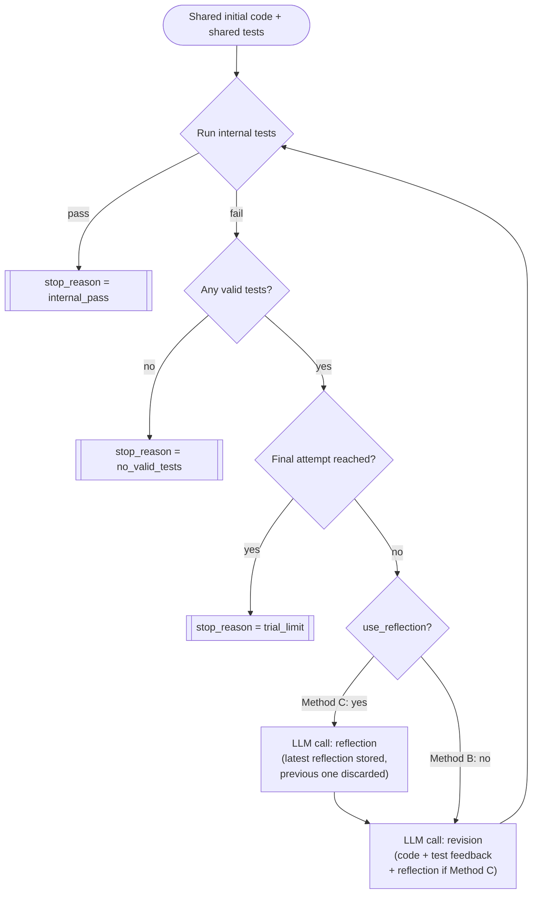
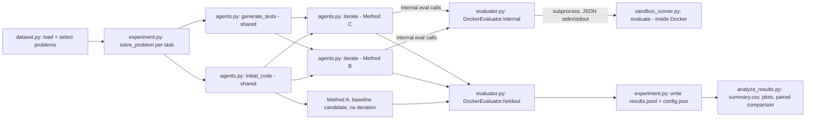

# Reproducing Reflexion: Does Verbal Self-Reflection Improve LLM Coding Agents?

**Authors:** Arun Munagala and Anuj Prakash
**Course:** Introduction to Computer Engineering, Indiana University
**Presentations:** 1 — Toolformer; 2 — Reflexion; 3 — AutoGen proactive
review (Method D).

**Status:** Harness implemented and verified (100 passing tests, including
14 real Docker integration tests). A real two-problem pilot and a real
20-problem HumanEval experiment (Methods A–D, `gpt-4o-mini`, seed 42) have
been run; see [Section 18](#18-results-and-output-interpretation) and
[Section 19](#19-current-project-status-and-remaining-work).

**Key reports:** [pilot findings](../verification/pilot_findings_report.md) ·
[final experiment report](../verification/final_experiment_report.md) ·
[Docker integration report](../verification/docker_integration_report.md) ·
[AutoGen design](AUTOGEN_DESIGN.md) ·
[implementation guide](IMPLEMENTATION_GUIDE.md).

> ## 📢 Path 2 update: AutoGen proactive review (Method D)
> Our final research direction has moved from Path 1 (this Reflexion
> reproduction alone) to **Path 2**: using this verified Reflexion
> implementation as an experimental **baseline** for a new comparison
> against a fourth method, **AutoGen proactive multi-agent review**,
> built with the real `autogen-agentchat` framework. Everything below
> describing Methods A/B/C (baseline, testing, Reflexion) is unchanged
> and preserved exactly as verified. For the new Method D, see
> **[`docs/AUTOGEN_DESIGN.md`](AUTOGEN_DESIGN.md)** (research
> motivation, architecture, algorithm, metrics, limitations) and
> [Section 17](#17-running-the-experiment) for the `--include-autogen`
> flag. The `path1-reflexion-reproduction` branch preserves this work
> exactly as it stood before the Path 2 pivot.

> For a deep, function-by-function walkthrough of every module, see
> [`docs/IMPLEMENTATION_GUIDE.md`](IMPLEMENTATION_GUIDE.md). This README
> is the entry point; the guide is the reference manual.

---

## Table of contents

1. [Project overview](#1-project-title-and-overview)
2. [Academic background](#2-academic-background-and-connection-between-our-presentations)
3. [Research question and hypothesis](#3-research-question-and-hypothesis)
4. [Reflexion explained simply](#4-reflexion-explained-simply)
5. [Experimental approaches](#5-experimental-approaches)
6. [Complete worked example](#6-complete-worked-example)
7. [Dataset](#7-dataset)
8. [Internal tests vs. held-out tests](#8-internal-tests-versus-held-out-tests)
9. [Architecture and repository structure](#9-architecture-and-repository-structure)
10. [Main algorithm and stopping conditions](#10-main-algorithm-and-stopping-conditions)
11. [Experimental controls and scientific validity](#11-experimental-controls-and-scientific-validity)
12. [Verification and implementation improvements](#12-verification-and-implementation-improvements)
13. [Metrics and planned analysis](#13-metrics-and-planned-analysis)
14. [Installation instructions](#14-installation-instructions)
15. [Docker setup and security](#15-docker-setup-and-security)
16. [LLM API configuration](#16-llm-api-configuration)
17. [Running the experiment](#17-running-the-experiment)
18. [Results and output interpretation](#18-results-and-output-interpretation)
19. [Current project status and remaining work](#19-current-project-status-and-remaining-work)
20. [Limitations](#20-limitations)
21. [Collaboration instructions](#21-collaboration-instructions)
22. [References](#22-references)

---

## 1. Project title and overview

This project investigates whether giving a coding LLM an explicit step to
**write a short natural-language explanation of its own mistake** — before
trying again — measurably improves its final correctness on programming
problems, compared to simply showing it the failing test output and asking
for a fix.

This is a **small-scale reproduction and adaptation** of the programming
experiments described in Shinn et al. (2023), *Reflexion: Language Agents
with Verbal Reinforcement Learning*. It is **not**:
- a new agent architecture,
- an attempt to exactly reproduce the paper's numerical results (different
  model, different sample size, different problem subset),
- a claim that any result we eventually observe generalizes beyond this
  harness and this model.

It **is**:
- a controlled, three-way comparison (single-shot generation vs.
  test-driven debugging vs. test-driven debugging *plus* explicit verbal
  reflection) run on the same LLM, same problems, same shared starting
  point, and the same official HumanEval scoring procedure,
- built, audited, and verified using an explicit "implement → question →
  verify → correct → re-verify" process, which is documented end-to-end in
  [Section 12](#12-verification-and-implementation-improvements) and the
  `verification/` folder, because our professor requires evidence of that
  process, not just a working script.

---

## 2. Academic background and connection between our presentations

Our three presentations form a logical progression:

**Presentation 1 — Toolformer** (Schick et al., 2023) showed that a
language model can learn, through self-supervised training, *when* and
*how* to call external tools (a calculator, a search API, a calendar) to
improve its own outputs. The key idea: a frozen or lightly-trained model
can get better by using feedback from the *outside world* (a tool's
return value), not just from its own internal weights.

**Presentation 2 — Reflexion** (Shinn et al., 2023) extends that idea one
step further: instead of (or in addition to) calling an external tool, the
agent uses feedback from *evaluating its own output* (e.g., running
generated tests) and converts that feedback into a short piece of
**natural-language self-criticism** ("I used the wrong loop bound; I
should iterate `n` times, not `n-1`"), which is then fed back into the
next generation attempt as working memory. Crucially, **the model's
weights are never updated** — all of the "learning" happens in the
text of the prompt across attempts. This is why the paper calls it
*verbal* reinforcement learning: it is RL-shaped (trial, feedback,
improved policy) but implemented entirely through natural language, not
gradient updates.

**Presentation 3 (this project)** is the AutoGen comparison: does proactive
multi-agent review (Method D) catch mistakes that failure-triggered
reflection overlooks? Its precursor question asks: does that verbal reflection step
actually contribute to the improvement, separately from the mundane fact
that showing the model *any* test failure and asking it to retry would
probably already help? The original paper reports a Python HumanEval
improvement from 80.1% to 91% for its full Reflexion pipeline, but that
number reflects the *entire* pipeline (generated tests, multiple retries,
*and* reflection) acting together. It does not, by itself, isolate how
much of that gain is attributable to the reflection step specifically,
as opposed to simply being allowed to see test failures and retry. The
paper's separate ablation on difficult HumanEval **Rust** problems does
provide evidence about the contribution of individual mechanisms, but
that evidence comes from a different language and a different, harder
problem subset — it does not directly tell us what reflection contributed
to the *Python* 80.1%→91% number specifically.

We also discussed, during Presentation 2, that the reliability of
LLM-*generated* tests is itself an open question (a test can be
syntactically plausible but semantically empty or wrong), and that we
noticed an apparent OR-vs-AND inconsistency in how Algorithm 1 in the
paper describes its stopping condition. **We are not claiming that the
authors' released code contains that same inconsistency** — we have not
inspected their repository in enough depth to make that claim, and the
`reflexion-reproduction` implementation in this repository is a new
implementation of our own, not a fork of theirs.

**The logical thread connecting all three presentations is:**
*tool use → feedback from the outside world → learning through verbalized
reflection on that feedback → our empirical attempt to verify whether the
reflection step in particular is pulling its weight.*

Everything in this section that is attributed to the original paper (the
80.1%→91% number, the Rust ablation, Algorithm 1) is a **reported result
from Shinn et al. (2023)**, not something we have measured ourselves. Any
number from *our own* experiment will be clearly labeled as ours, and as
the 20-problem experiment has now been run; its results are in
[Section 18](#18-results-and-output-interpretation).

---

## 3. Research question and hypothesis

> **Research question:** Does explicit verbal self-reflection improve an
> LLM coding agent's final correctness beyond ordinary test-based
> debugging?

**Hypothesis:** We expect that adding an explicit reflection step
(Method C) may improve the final held-out pass rate relative to
test-based debugging without reflection (Method B), because a reflection
forces the model to articulate a diagnosis before attempting a fix, which
*might* produce a more targeted revision than directly reacting to raw
test-failure text. **This was tested on a 20-problem sample (Section 18).** The run did not
establish a difference (Reflexion 19/20 vs Testing 17/20; exact two-sided
$p = 0.5$ on the two discordant problems), and it is entirely possible that Methods B and C perform
similarly, or that B outperforms C on this small sample, since reflection
adds inference cost and extra unconstrained generation without any
guarantee of a better outcome.

An inconclusive or negative result (no measurable difference, or B
outperforming C) would still be **scientifically informative**: it would
be consistent with the view that most of the published Reflexion gain
comes from the test-and-retry loop itself rather than from the verbal
reflection step specifically — directly relevant to the concern we raised
in Presentation 2. A small sample (planned: 20 main-experiment problems)
cannot establish statistical significance on its own, but it can produce
honest, reportable, paired evidence per problem, which is the right scope
for a course project.

---

## 4. Reflexion explained simply

The original Reflexion mechanism has five conceptual pieces:

| Concept | What it means |
|---|---|
| **Actor** | The LLM that generates a candidate solution (and revisions). |
| **Evaluator** | Something that scores a candidate — in the original paper and here, by running tests. |
| **Self-reflection** | A *separate* LLM call that converts a test failure into a short natural-language diagnosis. |
| **Natural-language memory** | The reflection text is stored and shown to the Actor on the next attempt, instead of (or alongside) numeric reward. |
| **Retry mechanism** | The Actor tries again, now conditioned on the stored reflection, up to a fixed attempt budget. |
| **Frozen weights** | None of this updates the model's parameters. All "learning" lives in the prompt text across attempts, for the duration of a single problem. |

**Ordinary RL vs. verbal RL:** In standard reinforcement learning, an
agent updates numeric parameters (weights) based on a scalar reward
signal. In *verbal* reinforcement learning, as Reflexion defines it, the
"update" is a piece of natural-language text appended to the next
prompt — there is no gradient step, no scalar reward threaded through a
loss function, and no change to the model checkpoint. The loop is: try →
observe outcome → write a sentence about what went wrong → try again with
that sentence in context.

**Mapping to our code:**
- Actor → `agents.py::initial_code` (first attempt) and the `revision`
  LLM call inside `agents.py::iterate` (subsequent attempts).
- Evaluator → `evaluator.py::DockerEvaluator.internal`, which runs
  LLM-generated tests inside a sandboxed container.
- Self-reflection → the `reflection` LLM call inside `agents.py::iterate`,
  only made when `use_reflection=True` (i.e., only in Method C).
- Natural-language memory → the `last_reflection` local variable in
  `agents.py::iterate`, which is overwritten (not accumulated) each
  attempt — we deliberately keep only the **most recent** reflection, a
  simplification relative to the original paper's potentially richer
  memory design.
- Retry mechanism → the `for attempt in range(1, max_attempts + 1)` loop
  in `agents.py::iterate`.
- Frozen weights → there is no training code anywhere in this repository;
  `llm.py` only ever makes inference (chat completion) calls.

---

## 5. Experimental approaches

All three methods begin from the **same shared initial candidate solution**
(`agents.py::initial_code`, called once per problem). Methods B and C
additionally share the **same generated internal tests**
(`agents.py::generate_tests`, also called once per problem) and the
**same maximum candidate-attempt budget** (`--max-attempts`, default 3).

| | Method A: Baseline | Method B: Testing | Method C: Reflexion |
|---|---|---|---|
| Starting candidate | Shared initial code | Shared initial code | Shared initial code |
| Generates internal tests? | No | Yes (shared with C) | Yes (shared with B) |
| Executes internal tests? | No | Yes | Yes |
| On test failure | N/A | Direct revision call, given code + failing test feedback | Separate reflection call first, then revision call given code + test feedback + **latest reflection** |
| Stores a persistent natural-language lesson? | No | No | Yes (latest only) |
| Max total candidates | 1 | `max_attempts` (default 3) | `max_attempts` (default 3) |
| Stop conditions | Always 1 generation | `internal_pass` / `no_valid_tests` / `trial_limit` | `internal_pass` / `no_valid_tests` / `trial_limit` |
| Extra LLM calls per failed attempt | 0 | 1 (revision) | 2 (reflection + revision) |

**Method D (AutoGen proactive review, Path 2)** uses the same shared initial
code and generated tests, but calls a reviewer on every attempt. A candidate
is accepted only if internal tests pass **and** the reviewer returns a valid
`APPROVE`; otherwise a programmer revises it, up to the same attempt budget.
See [`docs/AUTOGEN_DESIGN.md`](AUTOGEN_DESIGN.md).

### Control flow (Methods B and C)



This diagram matches the actual precedence order implemented in
`agents.py::iterate` after Stage 3 corrections: `internal_pass` is checked
first, then `no_valid_tests`, then `trial_limit` — see
[Section 10](#10-main-algorithm-and-stopping-conditions) for why this
order matters.

**Method B can "reason about" test feedback** because the failing test
text and the previous code are both included in its revision prompt — but
it never makes a separate call whose sole purpose is to produce a
standalone diagnosis, and nothing from that reasoning is stored as
persistent memory for later use. That is the precise, code-level
difference between B and C: **one extra LLM call, and one extra piece of
retained text, per failed non-terminal attempt.**

---

## 6. Complete worked example

> **This is an illustrative example only — these are not real model
> outputs or real experimental results.** It exists to make the control
> flow concrete before you read the actual code.

**Problem:** write `is_balanced(s)`, returning `True` if every `(` in `s`
has a matching, correctly-nested `)`.

**Shared initial candidate (illustrative, assume this is what the LLM
first generated):**
```python
def is_balanced(s):
    return s.count('(') == s.count(')')
```
This is wrong: it would incorrectly call `")("` balanced.

**A generated internal test that exposes the mistake:**
```python
assert is_balanced(")(") == False
```

**Internal evaluation failure feedback (illustrative):**
```
assert is_balanced(")(") == False: AssertionError
```

**Method B (testing-only) response:** the revision prompt contains the
previous code and the failure feedback above. The model is asked to
revise directly — no separate diagnosis is produced or stored. A
plausible revised candidate:
```python
def is_balanced(s):
    depth = 0
    for ch in s:
        if ch == '(':
            depth += 1
        elif ch == ')':
            depth -= 1
            if depth < 0:
                return False
    return depth == 0
```

**Method C (Reflexion) response:** before revising, a separate LLM call is
asked to explain the likely mistake in 1–3 sentences (illustrative):
> "The function only compares total counts of `(` and `)`, so it ignores
> ordering. It should track whether an unmatched `)` ever appears before
> its matching `(`, for example by tracking a running depth counter that
> must never go negative."

That reflection text is then included, alongside the same code and test
feedback, in the revision prompt. The resulting candidate may be
identical in substance to Method B's in this simple illustrative example
— the real empirical question is whether reflection helps more
consistently or on harder problems, which is exactly what running the
actual benchmark (run; see Section 18) addresses.

**Final evaluation:** both arms' final candidates are frozen, and *only
then* are they each run once against HumanEval's official hidden test
suite for that problem (not the internal test shown above), which is
never shown to the agent during generation or revision.

---

## 7. Dataset

We use the official **HumanEval** benchmark (Chen et al., 2021): 164
hand-written Python programming problems, each with:
- a **prompt**: a function signature plus a docstring (which may include
  illustrative examples),
- an **entry_point**: the name of the function to implement,
- a **canonical_solution**: the reference implementation,
- a **test**: a hidden `check(candidate)` function used for official
  scoring.

`dataset.py` implements the following, exactly:
- `load(path)`: reads the local `HumanEval.jsonl.gz` file, parses every
  line as JSON, verifies there are no duplicate `task_id`s, and returns
  the list sorted by `task_id`.
- `select(items, count, seed=42, exclude=())`: filters out any excluded
  `task_id`s, then uses `random.Random(seed).sample(...)` — a seeded,
  independent random generator (not the global `random` module) — to
  deterministically draw `count` problems. The same `seed` always
  produces the same subset.
- `public_problem(problem)`: a whitelist dict comprehension that returns
  **only** `task_id`, `prompt`, and `entry_point` — `canonical_solution`
  and `test` are never included in the object that gets passed toward any
  LLM-facing code path.
- Running `python dataset.py` directly downloads
  `data/HumanEval.jsonl.gz` from the official HumanEval GitHub raw URL if
  it is not already present, then prints the number of problems loaded
  and the file's **SHA256 hash** (also recorded in each run's
  `config.json`, for reproducibility).

**Planned selection for this project:** 20 problems for the main
experiment, drawn with `seed=42`, explicitly excluding `HumanEval/0` and
`HumanEval/1`, which are reserved as a separate 2-problem **pilot** set
used only to sanity-check the harness (API connectivity, Docker
execution, prompt formatting) before committing to the frozen main
sample. Pilot results are not combined with or substituted for main
-experiment results.

**Contamination caveat:** HumanEval is a public dataset that has been
available online for several years. Excluding its reference solutions and
official tests from our prompts prevents *this specific harness* from
directly leaking them during generation, but it is **not** proof that the
underlying model has never seen HumanEval problems (or their solutions)
during pretraining. Any benchmark number we eventually report must be
interpreted with that caveat in mind.

---

## 8. Internal tests versus held-out tests

This distinction is the backbone of the entire experiment's validity, so
it is worth stating plainly, twice, in different words.

**Internal tests** (sometimes called "generated tests" in this README):
- Generated by the LLM itself, from the public problem specification only
  (`agents.py::generate_tests`), never from the reference solution.
- Parsed and validated by `evaluator.py::parse_tests` before use (see
  [Section 10](#10-main-algorithm-and-stopping-conditions) and
  [Section 12](#12-verification-and-implementation-improvements) for the
  validation policy).
- Used exclusively to decide whether Methods B/C should stop early
  (`internal_pass`) or keep revising.
- **Shared identically** between Methods B and C for a given problem —
  generated once per problem, reused by both arms.
- Potentially incomplete, semantically wrong, or (pre-Stage-3-correction)
  vacuous — this is an acknowledged, partially-but-not-fully-mitigated
  limitation, not a solved problem.

**Official held-out tests** (HumanEval's `test` field):
- Written by the benchmark's original authors, not generated at runtime.
- Never included in any prompt sent to the LLM, at any stage, for any
  method (`public_problem()` strips them before anything reaches
  `agents.py`).
- Used **exactly once per candidate**, after that candidate has already
  been finalized by its own method's stopping logic
  (`evaluator.py::DockerEvaluator.heldout`, called from
  `experiment.py::solve_problem` only after all three arms' `iterate()`
  calls have already returned).
- The sole basis for every accuracy number we report.

**We deliberately never let the official tests influence the retry
loop.** `agents.py::iterate` has no reference to `heldout` anywhere in its
source (verified via a bytecode-level test,
`test_inv3_heldout_result_cannot_influence_revision_decision` in
`tests/test_extended_verification.py`) — it is structurally impossible for
a held-out result to change which candidate gets kept or how it gets
revised, because the retry loop's code does not call that function at
all. If we instead used the official test to decide when to stop, every
method would trivially converge toward "keep trying until it's actually
correct," which would make the comparison meaningless — it would no
longer measure anything about internal debugging or reflection, since the
oracle itself would be doing the work.

We have **not verified** differences between this implementation and the
authors' publicly released `noahshinn/reflexion` repository beyond what
is stated in [Section 2](#2-academic-background-and-connection-between-our-presentations)
(the Algorithm 1 OR/AND observation, which we explicitly do not claim
applies to their code) — we have not inspected their source in sufficient
depth to make further comparative claims, and this README will not invent
any.

---

## 9. Architecture and repository structure

```
reflexion-reproduction/
├── README.md                     # this file
├── requirements.txt               # openai, pytest, matplotlib
├── .env.example                   # placeholder env vars; never commit a real .env
├── .gitignore
├── dataset.py                     # HumanEval loading, hashing, reproducible sampling
├── llm.py                         # OpenAI-compatible chat completion adapter + event logging
├── agents.py                      # Method A/B/C logic: initial_code, generate_tests, iterate
├── evaluator.py                   # Host-side Docker orchestration + generated-test validation
├── sandbox_runner.py               # Executed INSIDE Docker only; runs candidate code + tests
├── experiment.py                   # CLI: orchestrates all 3 arms per problem, writes results.jsonl
├── analyze_results.py              # CLI: summary.csv, accuracy.png, tokens.png, paired comparison
├── docs/
│   └── IMPLEMENTATION_GUIDE.md     # function-by-function reference (see link at top of this file)
├── tests/
│   ├── test_harness.py             # original 11 tests (Stage 1, ChatGPT-authored)
│   ├── test_extended_verification.py  # 45 tests (Stage 2 audit + verification)
│   └── test_regressions.py         # 11 tests (Stage 3 before/after corrections)
└── verification/
    ├── NOTES.md                    # Stage 1 verification record
    ├── initial_tests.txt / revised_tests.txt        # Stage 1 before/after pytest output
    ├── copilot_verification_findings.md             # Stage 2 findings report
    ├── copilot_baseline_tests.txt                   # Stage 2: original 11 tests output
    ├── copilot_extended_tests_before.txt             # Stage 2: 45 new tests output
    ├── copilot_first_test_run.txt                    # Stage 2: honest record of 3 test-authoring mistakes
    ├── copilot_corrections_report.md                 # Stage 3 corrections report
    ├── copilot_regression_before.txt                 # Stage 3: regression tests pre-correction (6 failed)
    └── copilot_regression_after.txt                  # Stage 3: full suite post-correction (67 passed)
```

(Not shown: `.venv/`, `__pycache__/`, `.pytest_cache/`, `data/*.gz` — all
git-ignored; see [Section 14](#14-installation-instructions).)

### Module responsibilities

| Module | Key functions | Inputs → Outputs |
|---|---|---|
| `dataset.py` | `load`, `select`, `public_problem` | Downloads/reads `HumanEval.jsonl.gz` → list of problem dicts; whitelists public fields only |
| `llm.py` | `LLM.ask(stage, prompt)` | Prompt string → `Response(text, input_tokens, output_tokens, seconds, tokens_available)`; logs every call to `self.events` |
| `agents.py` | `initial_code`, `generate_tests`, `iterate` | Public problem dict → generated code string / parsed test list / full iteration record (code, history, attempts, stop_reason) |
| `evaluator.py` | `parse_tests`, `DockerEvaluator.internal`, `DockerEvaluator.heldout` | Raw LLM test text → validated test list; (code, tests) → `Evaluation(passed, feedback, status)` via an isolated Docker subprocess |
| `sandbox_runner.py` | `evaluate(data)` | JSON payload (code, tests, entry_point, kind) → JSON result dict; **executed only inside the Docker container**, never imported by the host process |
| `experiment.py` | `solve_problem`, `stats`, `main` | One problem → 3 result rows (baseline/testing/reflexion), each with code, history, token stats, held-out outcome |
| `analyze_results.py` | `summarize`, `main` | `results.jsonl` + `config.json` → `summary.csv`, `accuracy.png`, `tokens.png`, paired-comparison printout |

### End-to-end execution flow



### Suggested reading order for a new teammate

1. `README.md` (this file) end to end once, skimming code.
2. `dataset.py` — small, self-contained, establishes the public/secret
   field split that everything else depends on.
3. `llm.py` — the only place that talks to a real API; understand the
   event-logging shape before anything else.
4. `agents.py` — the actual Method A/B/C logic; this is the heart of the
   experiment.
5. `evaluator.py` then `sandbox_runner.py` together — the host/container
   split; note that `sandbox_runner.py` is never imported by the host, it
   is read as text and shipped into the container (`evaluator.py`'s
   `RUNNER` constant).
6. `experiment.py` — see how a single problem turns into 3 result rows,
   and exactly when `heldout` gets called relative to `iterate`.
7. `analyze_results.py` — the metrics layer.
8. `tests/test_harness.py` → `tests/test_extended_verification.py` →
   `tests/test_regressions.py`, in that order (this is also their
   chronological creation order).
9. `verification/copilot_verification_findings.md` and
   `verification/copilot_corrections_report.md` for the "why" behind every
   non-obvious line of code in `evaluator.py`, `sandbox_runner.py`,
   `agents.py`, and the token-usage handling in `llm.py`/`experiment.py`/
   `analyze_results.py`.

---

## 10. Main algorithm and stopping conditions

Pseudocode for `agents.py::iterate`, matching the actual implementation
after the Stage 3 corrections:

```
function iterate(llm, evaluator, problem, initial_code, tests, use_reflection, max_attempts):
    if max_attempts < 1: raise ValueError

    code = initial_code
    last_reflection = None
    history = []

    for attempt in 1 .. max_attempts:
        evaluation = evaluator.internal(code, tests, problem.entry_point)
        record (attempt, code, evaluation) in history

        if evaluation.passed:
            stop_reason = "internal_pass"
            break

        if tests is empty:
            stop_reason = "no_valid_tests"      # checked BEFORE the attempt-limit check
            break

        if attempt == max_attempts:
            stop_reason = "trial_limit"
            break

        feedback_context = problem.prompt + previous code + tests + evaluation.feedback

        if use_reflection:                       # Method C only
            last_reflection = llm.ask("reflection", feedback_context)
            record last_reflection in history[attempt]
            feedback_context += "\nMost recent reflection:\n" + last_reflection

        code = llm.ask("revision", feedback_context)

    return { code, attempts: len(history), history, internal_pass, stop_reason }
```

**Stop reasons, exactly as they appear in `results.jsonl`:**

| `stop_reason` | Meaning | Applies to |
|---|---|---|
| `single_generation` | Method A always stops after one generation; no internal evaluation ever happens. | Method A only |
| `internal_pass` | The candidate passed all internal tests on this attempt. | Methods B, C |
| `no_valid_tests` | No valid internal tests exist (`generate_tests`/`parse_tests` returned an empty list), so no internal evaluation can meaningfully occur. Checked **before** the attempt-limit condition, so it is reported correctly even if discovered on the final allowed attempt (Stage 3 correction — see [Section 12](#12-verification-and-implementation-improvements)). | Methods B, C |
| `trial_limit` | Valid internal tests existed and failed, and the maximum candidate-attempt budget was exhausted. | Methods B, C |

**Invalid/empty generated-test handling:** if `parse_tests` rejects the
LLM's output (wrong statement count, non-assert statements, no call to
the entry point, a syntax error, or — after Stage 3 — an obvious vacuous
assertion shape), it returns an empty list. `DockerEvaluator.internal`
treats an empty test list as an automatic failure
(`passed=False, status='no_tests'`) without launching a container at all,
and `sandbox_runner.evaluate` independently enforces the same rule as a
defense-in-depth guard, so an empty suite can never be miscounted as a
pass through either code path.

**Candidate-attempt counting:** `len(history)` is always exactly the
number of internal evaluations actually performed (1 to `max_attempts`),
regardless of which stop reason ended the loop. No extra LLM call is ever
made after the loop's final iteration — this is explicitly tested in
`tests/test_extended_verification.py`'s
`test_inv2_no_unnecessary_call_after_final_attempt_reflection_mode` /
`..._testing_mode`.

---

## 11. Experimental controls and scientific validity

| Control | Why |
|---|---|
| Same underlying LLM across all three methods | Isolates the method's effect; a model difference would confound any result. |
| Same benchmark problems (same `task_id`s, same order) | Removes problem-selection as a source of difference between methods. |
| Shared initial candidate solution | A/B/C start from an identical point; no method gets a "better first draft" by chance. |
| Shared internal tests (B and C only) | Any difference between B and C cannot be attributed to different test quality, since they use the literal same test strings. |
| Equal maximum candidate-attempt budget (B and C) | Both iterative methods get the same number of chances to converge. |
| Same official scoring procedure for every candidate | `DockerEvaluator.heldout` runs the identical official `check(candidate)` function for every method. |
| Separate, excluded pilot problems | Prevents us from tuning the harness on the same problems we will report results for. |
| Reproducible task selection (fixed seed, hashed dataset file) | Anyone re-running `dataset.select(..., seed=42)` against the same dataset file gets the identical subset. |

**Important asymmetry we do not paper over:** Method C makes **one extra
LLM call per failed, non-terminal attempt** (the reflection call) compared
to Method B. This means B and C have **equal candidate-attempt budgets**
but **not equal total inference budgets** (more LLM calls, more tokens,
more latency for C). We will not claim that any observed difference
between B and C is solely attributable to the *content* of reflection in
isolation from this extra compute — if C outperforms B, a careful reading
of our results must consider that C simply got more total model
"thinking" per problem, not only a qualitatively different kind of
thinking.

**What this experiment can establish:** whether, under these specific
controls, on this specific model, on this specific 20-problem subset,
adding an explicit reflection step changed the final held-out pass rate,
and by how much, paired per problem.

**What this experiment cannot establish:** that any observed effect
generalizes to other models, other problem distributions, larger sample
sizes, or an equal-compute-budget comparison; nor can a small sample
support a formal statistical significance claim.

---

## 12. Verification and implementation improvements

This project was built and verified in three chronological stages. We
document all of them because our professor requires evidence of an
actual "identify a concern → verify it executably → correct it →
re-verify" cycle, not just a final working script.

1. **ChatGPT-generated starter implementation** — the original
   `dataset.py`, `llm.py`, `agents.py`, `evaluator.py`,
   `sandbox_runner.py`, `experiment.py`, `analyze_results.py`.
2. **Initial 11 software tests** (`tests/test_harness.py`) — written
   alongside the starter implementation, using mocked LLMs and trusted
   fixtures only.
3. **Copilot read-only technical audit** — a full manual review of every
   module against the intended methodology, producing a prioritized list
   of suspected issues (P0/P1/P2) without changing any code.
4. **Student-directed verification** — the student (Arun) specifically
   directed investigation of five areas: vacuous generated tests, retry
   /stop-reason conditions, held-out isolation, metrics validity, and
   evaluator error handling.
5. **45 additional characterization and verification tests**
   (`tests/test_extended_verification.py`) — executed against the
   *unmodified* implementation to produce honest, reproducible evidence
   for each audit finding.
6. **11 regression tests** (`tests/test_regressions.py`), written to
   express the *intended corrected* behavior, run first against the
   *unmodified* implementation.
7. **Six regression failures, five passes, before correction** — saved
   verbatim in `verification/copilot_regression_before.txt`.
8. **Four targeted corrections** implemented in `evaluator.py`,
   `sandbox_runner.py`, `agents.py`, `llm.py`/`experiment.py`/
   `analyze_results.py` (details below).
9. **Final full suite: 67 passed, 0 failed**, saved in
   `verification/copilot_regression_after.txt`.

**Why characterization tests can "pass" while demonstrating undesirable
behavior:** a test like `test_inv1_wrong_fixture_passes_shortcircuit_vacuous_test`
is written to assert *that the defect occurs* — it passes precisely
*because* the defect is reproduced. A passing characterization test is
evidence that the concern is real, not evidence that the implementation
is correct. This is why `verification/copilot_verification_findings.md`
explicitly separates "confirmed defect" from "intentional design choice"
for every item it covers, and why some of those same tests were later
*reconciled* (not deleted) in Stage 3 once the underlying behavior was
corrected — each reconciled test's docstring in
`tests/test_extended_verification.py` explains both the original
assertion and the new one.

### A. Obvious vacuous generated-test assertions

- **Original behavior:** `evaluator.py::parse_tests` accepted any
  assertion containing, anywhere in its syntax tree, a call to the
  entry-point function — without checking whether that call would
  actually execute at runtime.
- **Why it mattered:** a wrong, deterministic candidate could pass an
  internal test purely due to the test's shape, letting Methods B/C
  stop early on an incorrect solution — directly undermining the
  "internal pass" and "false acceptance" metrics central to our
  Presentation 2 discussion of unreliable generated-test feedback.
- **How we verified it:** two concrete assertion shapes,
  `assert True or f(1) == 2` and `assert f(1) == f(1)`, were both shown
  to be accepted by the parser and both shown to pass against an
  intentionally wrong, deterministic fixture (`def f(x): return 999`).
  **Important distinction, exactly as it should be stated:** the
  short-circuit example (`True or f(1) == 2`) can pass **even when `f` is
  entirely undefined**, because the right-hand operand of `or` is never
  evaluated; the identical-expression example (`f(1) == f(1)`) **normally
  still requires `f` to exist**, because both sides of `==` are evaluated
  — it passes against a wrong-but-deterministic `f`, but raises
  `NameError` if `f` is missing. These are related but distinct failure
  modes, and this README (and the underlying verification report)
  deliberately does not conflate them.
- **Correction:** `evaluator.py::parse_tests` now rejects an assertion if
  it contains (a) a boolean `or`/`and` expression with a literal constant
  operand, or (b) an `==` comparison whose two sides are syntactically
  identical (`ast.dump(left) == ast.dump(right)`). This is a conservative,
  AST-based heuristic — it does **not** reject every assertion with
  multiple calls to the entry point (`f(f(1)) == 3` and
  `f(1) + f(2) == 5` both remain accepted), and it makes **no claim** to
  detect all meaningless or semantically-wrong generated tests; e.g., an
  assertion with a plausible-but-incorrect expected literal value is not
  caught by this check and remains a known, open limitation.
- **Reevaluation:** `tests/test_regressions.py::test_regr_01` and
  `test_regr_02` now pass; `test_regr_03`–`test_regr_05` confirm
  legitimate meaningful and compound assertions are still accepted.

### B. Missing explicit entry-point validation

- **Original behavior:** `sandbox_runner.py::evaluate` executed the
  candidate module and then directly executed each assertion, with no
  independent check that the entry point existed and was callable.
- **Why it mattered:** correctness was an accident of whichever assertion
  shape happened to be present — a vacuous assertion could mask a
  completely missing or non-callable entry point.
- **How we verified it:** a candidate that never defines `f`, and a
  candidate where `f` is bound to a non-callable value (`f = 5`), were
  both shown to pass a vacuous assertion while correctly failing a
  meaningful one.
- **Correction:** `sandbox_runner.py::evaluate` now calls an explicit
  `check_entry_point` helper immediately after executing the candidate
  module and **before** running any assertion, for both internal and
  held-out evaluation. A missing or non-callable entry point now fails
  uniformly, regardless of which assertion shape is present.
- **Reevaluation:** `test_regr_06` and `test_regr_07` now pass; correct
  candidates, syntax errors, and runtime exceptions retain their
  previously-correct behavior (`test_regr_08`, `test_regr_09`, and the
  unmodified syntax/exception tests in `test_extended_verification.py`).

### C. Ambiguous stop-reason classification

- **Original behavior:** `agents.py::iterate` checked
  `attempt == max_attempts` **before** `not tests`, so with
  `max_attempts=1` and an empty test list, the reported `stop_reason` was
  `trial_limit`, not `no_valid_tests`, even though the true cause was the
  absence of valid tests.
- **Why it mattered:** any later analysis that counts `no_valid_tests`
  occurrences (e.g., "test generation failed for N problems") would
  undercount exactly this edge case.
- **Correction:** the two checks were reordered so `no_valid_tests` is
  evaluated before `trial_limit`. No additional LLM calls were introduced;
  this is a pure reclassification of an existing early-exit path.
- **Reevaluation:** `test_regr_10` now passes.

### D. Missing token usage reported as measured zero

- **Original behavior:** `llm.py::LLM.ask` recorded `0` for
  `input_tokens`/`output_tokens` whenever the provider's response
  contained no usage block, indistinguishable from a genuinely-measured
  zero-token exchange.
- **Why it mattered:** a silent provider usage gap during a real paid run
  could produce a misleadingly low or zero-looking cost figure with no
  warning.
- **Correction:** `llm.py` now records `None` for token counts and an
  explicit `tokens_available=False` flag when usage is missing, and
  prints a warning at the moment it happens. `experiment.py::stats` and
  `analyze_results.py::summarize` propagate this distinction rather than
  silently summing unavailable data as zero, and the token plot labels an
  unavailable mode as `"unavailable"` instead of plotting a misleading
  zero-height bar.
- **Reevaluation:** `test_regr_11` now passes.

### Why these are harness-level improvements, not a new Reflexion claim

All four corrections make the **measurement harness** more trustworthy —
they reduce specific, demonstrated ways our own metrics could mislead us.
None of them change the Reflexion mechanism itself, introduce an
independent trusted verifier into the revision loop, or give any method
access to information it did not already have. They do not, on their own,
establish anything about whether reflection improves LLM coding
correctness — that remains an open, unanswered empirical question pending
the real benchmark run.

Full before/after evidence, exact test names, and file-level references
are in [`verification/copilot_verification_findings.md`](../verification/copilot_verification_findings.md)
(Stage 2) and [`verification/copilot_corrections_report.md`](../verification/copilot_corrections_report.md)
(Stage 3).

---

## 13. Metrics and planned analysis

| Metric | Definition |
|---|---|
| Held-out accuracy | % of problems where the final candidate passes HumanEval's official `check(candidate)`. |
| Problems solved | Raw count underlying the accuracy percentage. |
| Candidate attempts | `len(history)` from `iterate()`; 1 for baseline, 1–`max_attempts` for B/C. |
| Internal-test acceptance | Count of candidates where `internal_pass is True` (undefined/`None` for baseline, which never runs internal tests). |
| False acceptance | (internally-accepted candidates that **fail** held-out) ÷ (internally-accepted candidates). |
| Input/output tokens | Summed per arm from logged LLM events; see the availability caveat below. |
| Model call counts | Count of LLM events attributed to each arm (includes shared events — see below). |
| Latency | Wall-clock seconds attributed per arm, excluding held-out scoring time. |
| Paired comparison | Per-problem, whether Reflexion solved it and Testing did not, and vice versa. |

**False-acceptance worked example:** suppose Testing-mode internally
accepts 2 of 5 candidates (the other 3 never pass their internal tests),
and of those 2 internally-accepted candidates, 1 fails the official
held-out check. False acceptance = 1 ÷ 2 = **50%**. If zero candidates
were internally accepted, the denominator is zero and we report
`false_accept_pct_of_accepted = None` (unavailable), never `0%` — a zero
denominator is not the same as zero false acceptances.

**Unavailable vs. zero token usage:** after the Stage 3 correction, an
event where the provider returned no usage data is recorded with
`tokens_available=False` and `None` counts, not `0`. A mode is only
reported with a non-`None` `mean_total_tokens` if at least one of its rows
has available data; if a mode has any row with missing usage, that is
surfaced via `rows_missing_token_usage` and a printed warning, rather than
silently lowering the apparent average cost.

**Logically attributed vs. actual billed usage:** `experiment.py`
attributes the single shared initial-generation and shared
test-generation LLM events to *every* arm that logically uses them
(baseline counts the initial-generation call; testing and reflexion each
count both shared events plus their own revision/reflection calls). This
means the sum of `calls` (or tokens) reported across all three arms in
`summary.csv` is **larger than the actual number of distinct API calls
made**, because the two shared calls are counted multiple times. **Do not
sum per-arm token/call totals across modes to estimate real billed
experiment cost** — this is an intentional per-arm attribution choice,
documented and regression-tested
(`test_inv4_attributed_calls_exceed_actual_distinct_api_calls` in
`tests/test_extended_verification.py`), not a bug.

---

## 14. Installation instructions

Tested on macOS with Python 3.11 (via `venv`). Linux should work
identically; adjust shell-specific syntax as needed.

```bash
# 1. Clone the repository
# TODO: replace with the actual GitHub URL once the remote is configured
git clone <PLACEHOLDER_GITHUB_URL> reflexion-reproduction
cd reflexion-reproduction

# 2. Create and activate a virtual environment
python3 -m venv .venv
source .venv/bin/activate

# 3. Install dependencies
python -m pip install -r requirements.txt

# 4. Run the existing software verification tests (no API key needed)
python -m pytest -v tests/
```

You should see **100 passed** in the current suite (the earlier 67-test
breakdown in `verification/` logs is historical). If any test fails after a
fresh clone with an unmodified checkout, something is wrong with your
environment, not with the methodology — stop and investigate before
proceeding.

### What `.gitignore` already protects, and what it means for you

```
.venv/
.env
__pycache__/
.pytest_cache/
data/*.gz
```

- `.venv/` — your local virtual environment; never commit it.
- `.env` — where you will put your **real** API key locally
  (see [Section 16](#16-llm-api-configuration)); this file must never be
  committed. Only `.env.example` (a placeholder template with no real
  key) is tracked.
- `__pycache__/`, `.pytest_cache/` — compiled bytecode and pytest cache;
  no reason to ever commit these.
- `data/*.gz` — the downloaded HumanEval dataset archive; large and
  re-downloadable, so it is excluded, but it is also publicly available
  and not sensitive — this is a repository-hygiene choice, not a security
  one.

---

## 15. Docker setup and security

**Why we never execute LLM-generated code directly on the host:** the
candidate code and generated tests come from an LLM and are, by
definition, untrusted input. Running them with the full permissions of
your normal user account/host filesystem/network would be a serious
security risk regardless of how "harmless" a coding benchmark sounds —
and the official HumanEval repository itself explicitly warns about this.

**Our actual Docker configuration** (`evaluator.py::DockerEvaluator._run`):
- Base image: `python:3.11-slim`.
- `--network none` — no network access from inside the container.
- `--read-only` root filesystem, with a `--tmpfs /tmp:rw,noexec,nosuid,size=16m`
  scratch space (writable, but cannot execute new binaries from it, and
  cannot create setuid files).
- `--memory 256m`, `--cpus 1`, `--pids-limit 64` — resource limits to
  contain runaway or resource-exhausting candidate code.
- `--cap-drop ALL`, `--security-opt no-new-privileges` — drops all Linux
  capabilities and prevents privilege escalation inside the container.
- `--user 65534:65534` — runs as the conventional "nobody" UID/GID, not
  root.
- `--rm` — the container is deleted immediately after each run; nothing
  persists between evaluations.
- A fixed `--timeout` (default 15 seconds) enforced by the host-side
  `subprocess.run(..., timeout=...)` call, with a best-effort
  `docker rm -f` cleanup if a container times out.

**Before running any real experiment**, confirm Docker is installed,
running, and the image is present:

```bash
docker --version
docker info > /dev/null && echo "Docker daemon is running"
docker pull python:3.11-slim
docker image inspect python:3.11-slim > /dev/null && echo "Image present"
```

`experiment.py::main` also performs this same `docker image inspect`
check itself (via `DockerEvaluator.__init__`) before spending any API
budget, specifically so a missing Docker setup fails fast rather than
after paying for LLM calls.

**This is risk reduction, not a security guarantee.** We are not claiming
the sandbox is perfectly secure, and live integration tests (14) against a real Docker daemon
cover only the scenarios they exercise, not adversarial model output in
general — the Docker return-code and timeout
*classification logic* has been verified with **mocked** `subprocess.run`
calls (see `tests/test_extended_verification.py`'s
`test_inv5_docker_*` tests), but **live Docker integration testing is
still pending** (see [Section 19](#19-current-project-status-and-remaining-work)).
If you are running this against genuinely adversarial or unknown code, do
so inside an already-disposable VM, not merely inside this container
configuration on your primary machine.

---

## 16. LLM API configuration

**ChatGPT and GitHub Copilot were used as development assistants** during
this project — to generate the starter implementation, conduct the audit,
and help author/verify tests, as documented in
[Section 12](#12-verification-and-implementation-improvements). **Neither
of those tools is the experimental coding agent.** The actual benchmark
experiment requires a separately configured, programmatically accessible
chat-completion API that `llm.py` can call directly via the `openai`
Python package — Copilot Chat or a ChatGPT web session cannot be used as
that API, since they are not invoked as HTTP endpoints by `llm.py`.

**Environment variables supported by `llm.py` and `experiment.py`:**

| Variable | Required | Meaning |
|---|---|---|
| `OPENAI_API_KEY` | Yes | Your API key, read via `os.environ['OPENAI_API_KEY']` in `llm.py`. |
| `LLM_MODEL` | Yes (or pass `--model`) | The model ID to use; read via `os.getenv('LLM_MODEL')` as the default for `experiment.py --model`. |
| `OPENAI_BASE_URL` | No | Optional override for an OpenAI-API-compatible provider other than OpenAI itself. |

**How to configure them without exposing your key:**

```bash
cp .env.example .env
# edit .env and paste your real key — this file is already in .gitignore
set -a && source .env && set +a
```

or, without a file at all:

```bash
read -rs 'OPENAI_API_KEY?API key: '   # zsh; use `read -rs OPENAI_API_KEY` in bash
export OPENAI_API_KEY
export LLM_MODEL=<your-model-id>
```

**We are not specifying a model ID here**, and we have not configured or
tested any specific provider as part of this documentation pass — you
(or your teammate) must choose a real, accessible model ID yourselves
when you are ready to run the experiment.

**API costs:** running the pilot and the full 20-problem experiment will
incur real charges against whichever account's key you use (one initial
-generation call, one test-generation call, and up to `max_attempts`
revision/reflection calls per problem per iterative method). Check your
provider's pricing before running the full experiment.

---

## 17. Running the experiment

> **Commands below are labeled by whether they were run.** The pilot and
> final 20-problem experiments listed below have been run; see
> [Section 18](#18-results-and-output-interpretation) for their outputs.

All flags below are taken directly from `experiment.py`'s
`argparse` configuration; none are assumed or invented.

**1. Download HumanEval** *(run; dataset SHA-256 verified)*
```bash
python dataset.py
```
Downloads `data/HumanEval.jsonl.gz` if missing, then prints the number of
problems and the file's SHA256 hash.

**2. Run the two-problem pilot** *(run; results in `results/pilot_autogen/`, git-ignored)*
```bash
python experiment.py --pilot --out results/pilot
python analyze_results.py results/pilot
```
`--pilot` selects exactly `HumanEval/0` and `HumanEval/1`
(`experiment.py`'s `pilot = [x for x in items if x['task_id'] in
('HumanEval/0', 'HumanEval/1')]`). `--out` is required and must point to a
directory that **does not already exist** (`args.out.mkdir(..., exist_ok=False)`),
to protect prior results from accidental overwrite.

**3. Run the final 20-problem experiment** *(run; results in `results/final_autogen/`, git-ignored)*
```bash
python experiment.py --count 20 --seed 42 --max-attempts 3 --out results/final
python analyze_results.py results/final
```

**4. Change the number of problems** *(available, not yet used)*
```bash
python experiment.py --count 10 --seed 42 --out results/smaller_run
```
`--count` (default 20) and `--seed` (default 42) are both plain
`argparse` integer flags; decide on a sample size **before** looking at
any results, as the README's experimental-controls section requires.

**5. Change the maximum attempt budget** *(available, not yet used)*
```bash
python experiment.py --max-attempts 2 --out results/fewer_attempts
```
`--max-attempts` (default 3) must be a positive integer; `experiment.py`
calls `p.error('max-attempts must be positive')` otherwise.

**6. Run the analysis script** *(available, not yet used)*
```bash
python analyze_results.py <results_directory>
```
Reads `results.jsonl` and `config.json` from the given directory, verifies
every expected `(task_id, mode)` pair is present exactly once (refusing to
analyze an incomplete or duplicated run), then writes `summary.csv`,
`accuracy.png`, and `tokens.png`, and prints a paired Reflexion-vs-Testing
comparison to stdout.

**7. Include Method D (AutoGen proactive review)** *(available, not yet
run; requires `pip install -r requirements.txt` to have installed
`autogen-agentchat==0.7.5`)*
```bash
python experiment.py --pilot --include-autogen --out results/pilot_with_autogen
python analyze_results.py results/pilot_with_autogen
```
`--include-autogen` adds a fourth `autogen` mode alongside
baseline/testing/reflexion for every sampled problem, using the same
model, same shared initial candidate, and same shared generated tests.
Without this flag, the experiment behaves exactly as before (three
methods only); `autogen-agentchat` is only imported when this flag is
passed, so the original three-method experiment never requires it to be
installed. See [`docs/AUTOGEN_DESIGN.md`](AUTOGEN_DESIGN.md) for the
full algorithm and [Section 18](#18-results-and-output-interpretation)
for the additional fields this adds to `results.jsonl`/`summary.csv`.

**Full flag reference** (from `experiment.py`):

| Flag | Default | Meaning |
|---|---|---|
| `--model` | `$LLM_MODEL` | Model ID to use. |
| `--data` | `data/HumanEval.jsonl.gz` | Path to the dataset file. |
| `--count` | `20` | Number of main-experiment problems to sample. |
| `--seed` | `42` | Random seed for reproducible sampling. |
| `--max-attempts` | `3` | Candidate-attempt budget for Methods B/C/D. |
| `--pilot` | off | Use the fixed 2-problem pilot set instead of sampling. |
| `--include-autogen` | off | Also run Method D (AutoGen proactive review). |
| `--out` | *(required)* | Output directory; must not already exist. |

---

## 18. Results and output interpretation

Each run's `--out` directory contains (the final run is populated; the
files are git-ignored):

- **`config.json`** — model, seed, `max_attempts`, pilot flag, selected
  task IDs, dataset SHA256, Docker image name, and a note that only the
  latest reflection is retained.
- **`results.jsonl`** — one JSON object per `(task_id, mode)` pair,
  containing: the final `code`, the full attempt `history` (each
  attempt's code, internal evaluation result, and reflection text if
  any), `attempts`, `internal_pass`, `stop_reason`, token/call/latency
  stats, `heldout_pass`/`heldout_status`/`heldout_feedback`,
  `false_accept`, the generated `internal_tests`, and the complete
  `llm_events` log (every prompt and response actually sent/received for
  that arm).
- **`summary.csv`** — one row per mode, with `n`, `solved`,
  `accuracy_pct`, `internal_accepted`, `false_accept_count`,
  `false_accept_pct_of_accepted`, `mean_attempts`, `mean_calls`,
  `mean_total_tokens` (or absent/`None` if unavailable),
  `rows_missing_token_usage`, `mean_solve_seconds`.
- **`accuracy.png`** — bar chart of held-out pass rate per mode.
- **`tokens.png`** — bar chart of mean attributed tokens per mode, with
  any mode lacking usage data labeled `"unavailable"` rather than plotted
  as zero.

**To inspect an individual candidate's full history** (once real results
exist), open `results.jsonl`, find the row for the `task_id`/`mode` of
interest, and read its `history` list — each entry shows exactly what
code was tried, what the internal test feedback was, and (for Reflexion)
the exact reflection text generated before that attempt's revision.

### Final 20-problem results (official held-out correctness)

Model `gpt-4o-mini`, temperature 0, seed 42, max 3 candidate attempts,
Docker `python:3.11-slim` evaluator, 20 HumanEval problems.

| Method | Correct | Accuracy | Mean calls | Mean tokens | Mean latency |
|---|---:|---:|---:|---:|---:|
| Baseline | 17/20 | 85% | 1 | 392.2 | 3.18 s |
| Testing | 17/20 | 85% | 2.8 | 1432.4 | 8.40 s |
| Reflexion | 19/20 | 95% | 3.5 | 1996.75 | 9.62 s |
| AutoGen | 17/20 | 85% | 7 | 5163.75 | 19.52 s |

- **Tokens** are per-problem means of input + output tokens. Shared calls
  (`initial_code`, `generate_tests`) are attributed logically to each method,
  so the per-method totals **must not be summed** to estimate API billing.
- **Official correctness** is the held-out HumanEval test result. **Internal
  acceptance** means the generated tests passed; it is a different quantity.
  Internal tests were wrong or out of spec on several problems, so internal
  acceptance is a weak proxy for correctness on this sample.
- **Reviewer (AutoGen):** 60 reviewer decisions, all valid JSON, all
  `REVISE`; **zero `APPROVE`**; therefore **zero workflow-accepted candidates**,
  and all 20 runs stopped at the trial limit.
- **Paired result:** Reflexion-only successes were HumanEval/105 and /163;
  AutoGen had no exclusive successes. Exact two-sided $p = 0.5$. The sample
  cannot distinguish the methods.
- **Missing numpy:** the sandbox image (`python:3.11-slim`) lacks `numpy`. Some
  generated candidates import it and fail with `ModuleNotFoundError`. This is
  an environment compatibility limitation affecting some results, not a
  production-code defect.

Full analysis: [`verification/final_experiment_report.md`](../verification/final_experiment_report.md).
Pilot (2 problems): [`verification/pilot_findings_report.md`](../verification/pilot_findings_report.md).

**Compact evidence (Git-tracked):** `verification/final_run_config.json`,
`verification/final_summary.csv`, `verification/final_task_outcomes.csv`,
`verification/pilot_summary.csv`. The full `results.jsonl` files, including
all LLM prompts and responses, are git-ignored and local only. This repository
therefore contains compact evidence, **not** the complete raw LLM transcript.
An independent rerun can produce different LLM outputs even with identical
settings.

---

## 19. Current project status and remaining work

**Git checkpoints:**
- `889c7cd` — Initial Reflexion reproduction implementation.
- `9050f0c` — Verify original implementation and document evaluator weaknesses.
- `067de57` — Correct verified evaluator defects and validate regression tests.

**Completed:**
- [x] Initial ChatGPT-generated Reflexion reproduction implementation.
- [x] Original 11 software tests.
- [x] Copilot read-only technical audit.
- [x] Student-directed executable verification; 45 additional tests.
- [x] Identification of vacuous-test acceptance, missing entry-point
  validation, stop-reason ambiguity, and missing-token-usage reporting
  weaknesses.
- [x] 11 regression tests against the original implementation.
- [x] Four targeted implementation corrections.
- [x] Full reevaluation: 67/67 tests passing.
- [x] This documentation pass (README + implementation guide).
- [x] **Path 2 pivot:** Method D (AutoGen proactive review) implemented
  on a separate `path2-autogen` branch (`autogen_agents.py`), integrated
  into `experiment.py` behind `--include-autogen`, and
  `analyze_results.py` updated to validate/report both three- and
  four-method experiments. 16 new executable verification tests added
  (`tests/test_autogen_agents.py`); full suite **83/83 passing**
  (see `verification/copilot_autogen_tests.txt`). Design rationale in
  [`docs/AUTOGEN_DESIGN.md`](AUTOGEN_DESIGN.md).

**Completed since the Path 2 pivot:**
- [x] Real Docker integration tests (14), against the configured container,
  with a report in [`verification/docker_integration_report.md`](../verification/docker_integration_report.md).
- [x] Real LLM API configuration (`gpt-4o-mini`, temperature 0, seed 42).
- [x] Two-problem pilot, with findings in [`verification/pilot_findings_report.md`](../verification/pilot_findings_report.md).
- [x] Frozen configuration and final 20-problem HumanEval experiment.
- [x] Benchmark analysis and report in [`verification/final_experiment_report.md`](../verification/final_experiment_report.md).
- [x] Full test suite: 100 passing.

**Remaining work:**
- [ ] Pre-register any larger experiment before running it.
- [ ] Decide whether to add `numpy` to the sandbox image (a methodology change).
- [ ] Slides and appendix preparation.

---

## 20. Limitations

- **Reviewer behaviour.** The AutoGen reviewer never approved, so the
  acceptance path was never exercised. Whether the reviewer prompt causes
  excessive criticism is a hypothesis; no ablation was run.
- **Model choice.** One model (`gpt-4o-mini`). Results may not transfer.
- **Prompt design.** Prompts were written once and not tuned; a different
  prompt could change the outcome.
- **Missing numpy dependency.** The sandbox image lacks `numpy`, which
  affects some candidates (HumanEval/105 and /163). This is an environment
  compatibility limitation, not a production-code defect.
- **Generated-test quality.** Several shared generated tests contradict the
  public specification or use out-of-domain inputs (see the final report,
  section 8). This affects internal acceptance and reviewer feedback.
- **Public benchmark.** HumanEval is public; contamination cannot be ruled
  out.
- **Small sample size.** 20 main-experiment problems (plus a 2-problem
  pilot) cannot support a statistically significant claim on their own;
  results should be read as paired, qualitative evidence per problem.
- **Model differences from the original paper.** We have not committed to
  a specific model; whatever model we use will almost certainly differ
  from the original paper's experimental setup, so no numerical
  comparison to the paper's reported 80.1%/91% is valid.
- **Public benchmark contamination.** HumanEval is public; we cannot rule
  out that our chosen model encountered it during pretraining.
- **Imperfect generated tests.** Our Stage 3 correction removes two
  specific, obvious vacuous-assertion shapes; it does not detect
  incomplete coverage or plausible-but-incorrect expected values in
  generated tests.
- **Extra computation for reflection.** Method C makes strictly more LLM
  calls than Method B per failed attempt; any accuracy difference we
  observe is not isolated from this extra compute.
- **Simplified reflection memory.** We retain only the single most recent
  reflection, a simplification relative to any richer memory scheme the
  original paper may use.
- **Conservative generated-test validation.** Deliberately narrow, by
  design — it targets two specific vacuous shapes and explicitly avoids
  broader, riskier heuristics that might reject legitimate tests.
- **Docker isolation limitations.** Strong resource/capability
  restrictions, but explicitly not claimed to be a perfect security
  boundary; 14 live integration tests run against a real Docker daemon.
  They are not a formal security proof.
- **Differences from an exact reproduction.** This is a from-scratch
  harness inspired by, not copied from, the original authors' released
  implementation; we have not systematically compared our control flow
  against theirs beyond the one Algorithm-1 observation noted in
  [Section 2](#2-academic-background-and-connection-between-our-presentations).
- **Passing software tests is not the same as improved benchmark
  performance.** The 100 passing tests validate the *harness's* logical
  correctness, using mocked LLMs, fixtures, and 14 Docker integration tests.
  They do not show whether a real LLM's reflections help. That question is
  addressed only by the 20-problem run in Section 18, which is a small sample.

---

## 21. Collaboration instructions

**For Anuj (or anyone joining this project fresh):**

```bash
# 1. Clone the repository
git clone <PLACEHOLDER_GITHUB_URL> reflexion-reproduction
cd reflexion-reproduction

# 2. Pull the latest changes (if already cloned)
git pull origin main

# 3. Create a separate working branch before making any changes
git checkout -b your-name/your-feature

# 4. Set up the environment and confirm the baseline still passes
python3 -m venv .venv && source .venv/bin/activate
python -m pip install -r requirements.txt
python -m pytest -v tests/        # expect 100 passed

# 5. Inspect verification evidence before changing anything
#    (read in this order — see Section 9's reading order for full code)
open verification/copilot_verification_findings.md
open verification/copilot_corrections_report.md
```

**Suggested review order:** this README → `docs/IMPLEMENTATION_GUIDE.md`
→ the code reading order in [Section 9](#9-architecture-and-repository-structure)
→ `verification/copilot_verification_findings.md` →
`verification/copilot_corrections_report.md`.

**To contribute without disrupting `main`:** always work on a feature
branch, run the full test suite before opening a pull request, and never
force-push over `main`. If you add or modify production behavior, add or
update tests in the appropriate `tests/` file and, if you are correcting
a previously-identified issue, follow the same before/after evidence
pattern already established in `verification/` rather than silently
editing code.

---

## 22. References

- Schick et al. (2023), [Toolformer: Language Models Can Teach Themselves
  to Use Tools](https://arxiv.org/abs/2302.04761).
- Shinn et al. (2023), [Reflexion: Language Agents with Verbal
  Reinforcement Learning](https://arxiv.org/abs/2303.11366).
- [Official Reflexion repository](https://github.com/noahshinn/reflexion).
- Chen et al. (2021), [Official HumanEval
  repository](https://github.com/openai/human-eval) (dataset downloaded
  separately; MIT license).
